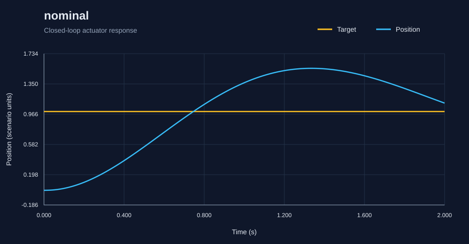
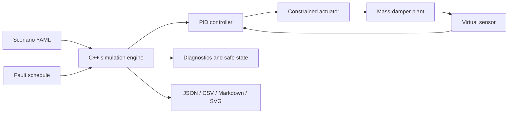

# RoboSim V&V

**A C++17 toolkit for reproducible actuator simulations, fault injection, and verification reports.**

Define a robotic actuator experiment in YAML, run its closed-loop PID controller,
inject sensor or communication faults, and inspect the response. RoboSim models
a constrained actuator and a mass-damper plant with virtual sensors, diagnostics,
and latched safe-state transitions.



*Generated by the C++ engine. Explore the [scenario summary](results/all/summary.md)
and [nominal report](results/all/nominal/report.md).*

## Features

- Fixed-step simulations with seeded noise and reproducible runs.
- PID control with anti-windup, actuator saturation/slew, and motion constraints.
- Fixed, step, ramp, and interpolated multi-point targets.
- Sensor noise, bias, drift, quantization, latency, dropout, and stuck readings.
- Scheduled communication interruptions, emergency stops, and actuator faults.
- Tracking metrics, diagnostic events, and configurable acceptance criteria.
- JSON, CSV, Markdown, and native SVG plots with no Python or plotting runtime.
- A reusable C++ library, native tests, and Linux/Windows CI.

## Build

You need **CMake 3.24+** and a **C++17 compiler**: GCC 9+, Clang 10+, or Visual
Studio 2022 with the Desktop development with C++ workload. The first configure
downloads pinned [yaml-cpp](https://github.com/jbeder/yaml-cpp) and
[nlohmann/json](https://github.com/nlohmann/json) source releases.

```sh
git clone https://github.com/LouayHM3/RobSim.git
cd RobSim
cmake -S . -B build -DCMAKE_BUILD_TYPE=Release
cmake --build build --config Release --parallel
ctest --test-dir build -C Release --output-on-failure
```

### Windows PowerShell (Visual Studio)

```powershell
.\build\Release\robosim.exe run scenarios/nominal.yaml --output results/nominal
.\build\Release\robosim.exe verify scenarios --output results/verification
```

### Linux / macOS

```sh
./build/robosim run scenarios/nominal.yaml --output results/nominal
./build/robosim verify scenarios --output results/verification
```

Single-configuration Windows generators put the executable at `build/robosim.exe`.
The commands below use `robosim` for brevity; substitute your executable's path.
You can optionally install it using `cmake --install build --config Release --prefix install`.

For offline builds, install the dependency CMake packages and configure with
`-DROBOSIM_USE_SYSTEM_DEPS=ON`.

## Run experiments

| Task | Command |
| --- | --- |
| Print simulation metrics | `robosim run scenarios/nominal.yaml` |
| Export JSON and CSV | `robosim run scenarios/nominal.yaml --json results/nominal.json --csv results/nominal.csv` |
| Save a vector plot | `robosim run scenarios/nominal.yaml --plot results/nominal.svg` |
| Write a complete report bundle | `robosim run scenarios/nominal.yaml --output results/nominal` |
| Verify one scenario | `robosim verify scenarios/nominal.yaml` |
| Verify every scenario | `robosim verify scenarios --output results/verification` |
| Benchmark repeated simulations | `robosim benchmark scenarios/nominal.yaml --repeats 3` |

`verify` and `benchmark` return **0** when acceptance criteria pass and **1** when
they fail. `run` returns 0 after completion regardless of acceptance; use `verify`
in automation. Invalid inputs and I/O failures return **2**.

Directory verification processes `.yaml` and `.yml` files in filename order and
adds `summary.md` and `summary.json`. Single-file verification prints metrics;
add `--output` to save its bundle. Use `robosim --help` for CLI syntax.

## Configure a scenario

The included [nominal scenario](scenarios/nominal.yaml) is ready to run:

```yaml
name: nominal
duration: 2.0
dt: 0.01
seed: 7
target: 1.0
acceptance:
  final_error: 0.12
plant: {mass: 1.0, damping: 0.4, limit: 10.0}
pid: {kp: 6.0, ki: 1.0, kd: 0.8, output_min: -10.0, output_max: 10.0}
actuator: {maximum: 10.0, slew_rate: 100.0}
sensor: {noise_std: 0.0}
safety: {error_limit: 5.0, command_limit: 10.0, dropout_limit: 3}
```

Copy it and change the gains, limits, target, or sensors. Replace `target` with
an interpolated trajectory:

```yaml
trajectory:
  type: multi-point
  points:
    - {time: 0.0, value: 0.0}
    - {time: 1.0, value: 1.0}
    - {time: 2.0, value: 0.5}
```

To test dropout handling, add these top-level settings, replacing the existing
`acceptance` block:

```yaml
faults:
  - {type: sensor_dropout, start: 0.3, end: 1.0}
acceptance:
  expected_safe: true
```

Choose acceptance criteria suitable for each experiment. A normal case passes when
its safe-state outcome matches expectations and final absolute error is within
`acceptance.final_error`. With `expected_safe: true`, reaching safe state replaces
the error threshold. `expected_emergency_stop: true` additionally requires a stop.
A passing fault case means the expected safety response occurred.

## Included scenarios

| Scenario | Behavior exercised |
| --- | --- |
| [Nominal](scenarios/nominal.yaml) | Baseline tracking |
| [Sensor noise](scenarios/sensor_noise.yaml) | Noisy feedback |
| [Sensor dropout](scenarios/sensor_dropout.yaml) | Missing feedback and safe state |
| [Sensor drift](scenarios/sensor_drift.yaml) | Drifting measurements |
| [Sensor stuck](scenarios/sensor_stuck.yaml) | Frozen feedback |
| [Communication interruption](scenarios/communication_interruption.yaml) | Interrupted feedback |
| [Actuator saturation](scenarios/actuator_saturation.yaml) | Limited actuation and safety response |
| [Emergency stop](scenarios/emergency_stop.yaml) | Scheduled stop handling |

## Inspect the output

```text
results/nominal/
  report.md            Outcome, metrics, diagnostics, and plot links
  metrics.json         Machine-readable metrics
  result.json          Metrics, samples, diagnostics, and events
  timeseries.csv       Per-step data
  events.json          Fault events and diagnostics
  trajectory.svg       Target and position
  tracking_error.svg   Tracking error
```

Metrics include RMSE, final error, control effort, overshoot, settling time,
constraint counts, measurement age, and safe-state timing. See
[metric definitions and limitations](docs/verification.md). Tracked
[example results](results/all) are generated from C++; rerun scenarios to assess
your own configuration.

## Architecture



The plant uses semi-implicit Euler integration. The safe state removes applied
force while existing velocity decays with damping. This simplified model supports
simulation experiments; it does not establish physical robot safety.

```text
include/robosim/   Public C++ library API
src/              Scenario loading, components, engine, metrics, reporting, CLI
tests/            Native simulation and output tests
scenarios/        YAML experiments retained from the Python version
docs/             Architecture, model, verification, and migration notes
results/all/      Generated C++ example reports and plots
```

## Documentation and development

- [Architecture](docs/architecture.md) and [simulation model](docs/simulation-model.md)
- [Scenario configuration](docs/scenarios.md)
- [Verification plan](docs/verification-plan.md) and [requirements traceability](docs/requirements-traceability.md)
- [Reproduce test results](docs/test-results.md)
- [Contributing](CONTRIBUTING.md)
- [Python to C++ migration notes](docs/migration.md)

Version 0.2.0 is a native C++ implementation. Original Python code remains in Git
history. Noise sequences change with the new generator, and plots now use SVG.
CI builds/tests Linux and Windows and runs Linux address/undefined-behavior sanitizers.

See [LICENSE](LICENSE) for the included license terms.
