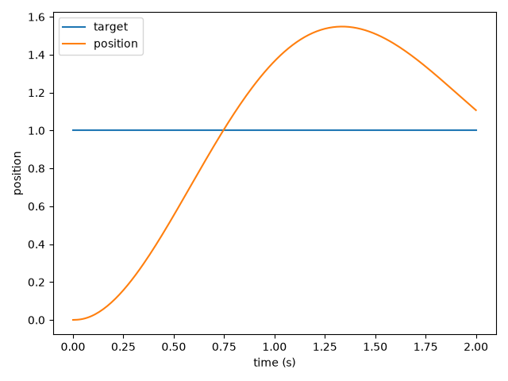
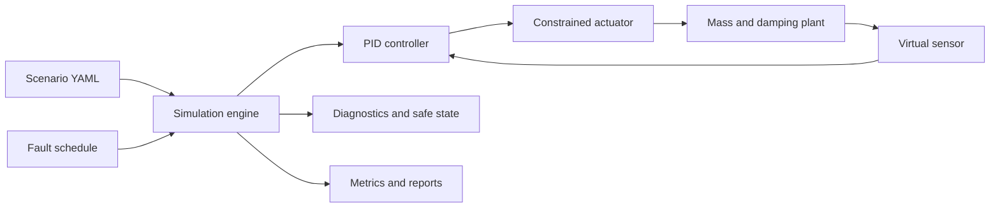

# RoboSim V&V

**Reproducible actuator simulations, fault injection, and verification reports in Python.**

RoboSim models a closed-loop robotic actuator: a PID controller drives a mass-and-damping plant through a constrained actuator, while a virtual sensor feeds measurements back into the loop. Define an experiment in YAML, inject faults, and inspect tracking performance, diagnostics, and transitions to a safe state.

Designed for exploring control behavior and building repeatable verification and validation (V&V) experiments. Requires **Python 3.11+**.

## See it in action



*Example nominal run: target versus simulated position. Explore the [scenario summary](results/all/summary.md) and [nominal report](results/all/nominal/report.md) for the recorded metrics.*

## What you can do

- **Repeat experiments:** fixed simulation steps and seeded sensor noise make runs reproducible for the same configuration and environment.
- **Test trajectories:** fixed targets, steps, ramps, and interpolated multi-point paths.
- **Model constraints:** actuator saturation and slew rate, velocity and acceleration constraints, and plant position limits.
- **Inject faults:** sensor dropout, drift, stuck readings, communication interruptions, and emergency stops; configure sensor noise and latency.
- **Inspect behavior:** tracking errors, control effort, limit violations, measurement age, diagnostic events, and safe-state timing.
- **Export evidence:** Markdown reports, JSON metrics and events, CSV time series, and trajectory/error plots.

## Quick start

From the project directory, create and activate a virtual environment:

**Windows PowerShell**

```powershell
python -m venv .venv
.\.venv\Scripts\Activate.ps1
```

**Linux / macOS**

```bash
python3 -m venv .venv
source .venv/bin/activate
```

Install the project and run your first experiment:

```bash
python -m pip install -e ".[dev,plot]"
robosim run scenarios/nominal.yaml --output results/nominal
robosim verify scenarios/nominal.yaml
```

Open `results/nominal/report.md` for the outcome and `results/nominal/trajectory.png` for the response plot. You can also invoke the CLI as `python -m robosim`.

## Run and verify

| Task | Command |
| --- | --- |
| Print one simulation's metrics | `robosim run scenarios/nominal.yaml` |
| Export JSON and CSV | `robosim run scenarios/nominal.yaml --json results/nominal.json --csv results/nominal.csv` |
| Save a trajectory plot | `robosim run scenarios/nominal.yaml --plot results/nominal.png` |
| Generate a complete report bundle | `robosim run scenarios/nominal.yaml --output results/nominal` |
| Verify one scenario | `robosim verify scenarios/nominal.yaml` |
| Verify all YAML scenarios and save reports | `robosim verify scenarios --output results/verification` |
| Time repeated simulations | `robosim benchmark scenarios/nominal.yaml --repeats 3` |

`verify` returns exit code **0** when acceptance criteria pass and **1** when they fail. Directory verification reads the directory's `*.yaml` files, writes a bundle for each scenario, and creates `summary.md` and `summary.json`. Single-file verification prints metrics; use `run --output` to save its bundle. `run` returns 0 after a completed simulation even if its acceptance criteria fail, so use `verify` for automated checks.

### How acceptance works

A normal scenario passes when its safe-state outcome matches the expected outcome and its final absolute tracking error is within `acceptance.final_error`. With `acceptance.expected_safe: true`, entering the safe state is the expected success condition; the final tracking-error threshold is then bypassed. An optional `expected_emergency_stop: true` also requires a recorded emergency stop.

A passing fault scenario therefore means the configured safety response occurred. It does not necessarily mean the actuator reached its target.

## Define an experiment

The included [nominal scenario](scenarios/nominal.yaml) is a complete starting point:

```yaml
name: nominal
duration: 2.0
dt: 0.01
seed: 7
target: 1.0
acceptance:
  final_error: 0.12
plant: {mass: 1.0, damping: 0.4, limit: 10.0}
pid: {kp: 6.0, ki: 1.0, kd: 0.8, output_min: -10.0, output_max: 10.0}
actuator: {maximum: 10.0, slew_rate: 100.0}
sensor: {noise_std: 0.0}
safety: {error_limit: 5.0, command_limit: 10.0, dropout_limit: 3}
```

Copy it to a new YAML file and adjust the controller gains, limits, or sensor settings. Replace the fixed `target` with a trajectory, for example:

```yaml
trajectory:
  type: multi-point
  points:
    - {time: 0.0, value: 0.0}
    - {time: 1.0, value: 1.0}
    - {time: 2.0, value: 0.5}
```

To exercise dropout handling, add a fault schedule and expect a safe-state transition:

```yaml
faults:
  - {type: sensor_dropout, start: 0.3, end: 1.0}
acceptance:
  expected_safe: true
```

After changing a trajectory or fault, choose acceptance criteria appropriate to the experiment. See the [scenario guide](docs/scenarios.md) for configuration details.

## Included scenarios

| Scenario | Behavior exercised |
| --- | --- |
| [Nominal](scenarios/nominal.yaml) | Baseline tracking without injected faults |
| [Sensor noise](scenarios/sensor_noise.yaml) | Tracking with noisy measurements |
| [Sensor dropout](scenarios/sensor_dropout.yaml) | Missing feedback and safe-state response |
| [Sensor drift](scenarios/sensor_drift.yaml) | Drifting measurements |
| [Sensor stuck](scenarios/sensor_stuck.yaml) | Frozen sensor feedback |
| [Communication interruption](scenarios/communication_interruption.yaml) | Interrupted feedback communication |
| [Actuator saturation](scenarios/actuator_saturation.yaml) | Constrained actuation and safety response |
| [Emergency stop](scenarios/emergency_stop.yaml) | Scheduled emergency-stop handling |

## Reports you can inspect

Each complete output bundle contains:

```text
results/nominal/
  report.md            Human-readable outcome, metrics, and diagnostics
  metrics.json         Machine-readable metrics
  result.json          Metrics, samples, diagnostics, and events
  timeseries.csv       Per-step simulation data
  events.json          Fault events and diagnostic messages
  trajectory.png       Target and position over time
  tracking_error.png   Tracking error over time
```

The checked-in [example results](results/all) let you explore the output before running anything. Generate a fresh run to evaluate your current code and configuration.

## How it works



The plant uses semi-implicit Euler integration. For force `u`, damping `c`, mass `m`, and step `dt`:

```text
v(k+1) = v(k) + ((u - c*v(k)) / m) * dt
x(k+1) = x(k) + v(k+1) * dt
```

Configured limits constrain the response. The safe state removes applied plant force; it does not instantly eliminate existing velocity. This is a simplified one-dimensional model for simulation experiments; its results do not establish physical robot safety or certification.

## Development

```bash
python -m pip install -e ".[dev,plot]"
python -m pytest
python -m ruff check .
python -m mypy src
python -m robosim verify scenarios --output results/verification
```

The GitHub Actions workflow runs Ruff and pytest on Python 3.11. Tests cover deterministic nominal tracking, bounded PID output, dropout and emergency-stop responses, scenario loading, and report artifacts. See [CONTRIBUTING.md](CONTRIBUTING.md) for contribution guidance.

```text
src/robosim/   Simulation components, metrics, reporting, and CLI
scenarios/     YAML experiments and fault schedules
tests/         Simulation and output tests
docs/          Model, architecture, and verification documentation
results/all/   Checked-in example reports and plots
```

## Documentation

- [Architecture](docs/architecture.md)
- [Simulation model](docs/simulation-model.md)
- [Scenarios and faults](docs/scenarios.md)
- [Verification plan](docs/verification-plan.md)
- [Requirements traceability](docs/requirements-traceability.md)
- [Test results and reproduction commands](docs/test-results.md)

## License

See [LICENSE](LICENSE) for the included license terms.

