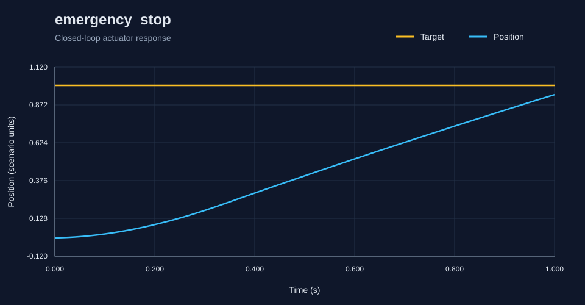
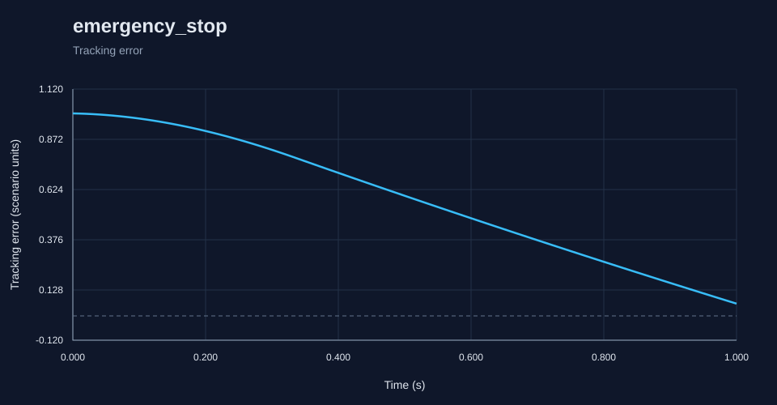

# RoboSim report: emergency_stop

Generated by the C++ simulation engine.

Status: **PASS**

## Metrics

- **acceleration_limit_violations**: 0
- **actuator_acceleration_violations**: 0
- **actuator_velocity_violations**: 0
- **command_limit_violations**: 0
- **control_effort**: 1.1995200710126621
- **diagnostic_count**: 2
- **duration**: 1.0
- **emergency_stop**: true
- **fault_count**: 66
- **fault_detection_latency**: 0.0
- **feedback_delay_diagnostics**: 0
- **final_error**: 0.06047897806775049
- **integral_absolute_error**: 0.5882248917768047
- **integral_squared_error**: 0.43257639304519724
- **invalid_readings**: 0
- **max_command**: 4.002
- **max_error**: 0.9995998
- **max_velocity**: 1.1568295298801088
- **mean_absolute_error**: 0.5824008829473314
- **mean_measurement_age**: 0.0
- **overshoot**: 0.0
- **passed**: true
- **peak_error**: 0.9995998
- **position_limit_violations**: 0
- **reason**: pass
- **rise_time**: 0.97
- **rmse**: 0.6544413330930369
- **safe_state**: true
- **safe_state_time**: 0.35000000000000003
- **samples**: 101
- **saturation_fraction**: 0.3465346534653465
- **scenario**: emergency_stop
- **sensor_unchanged_diagnostics**: 0
- **settling_time**: null
- **steady_state_error**: 0.10633753876574485
- **velocity_limit_violations**: 0

## Diagnostics

- `0.35s` WARNING EMERGENCY_STOP: fault active: emergency_stop
- `0.35s` ERROR SAFE_STATE: emergency stop requested
