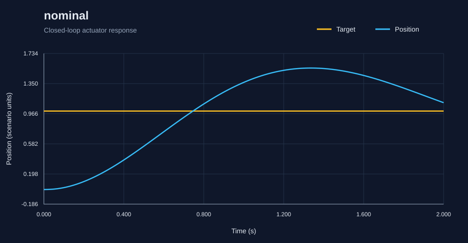
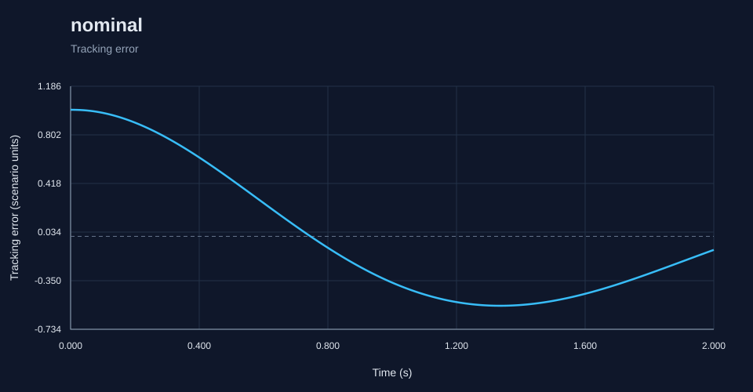

# RoboSim report: nominal

Generated by the C++ simulation engine.

Status: **PASS**

## Metrics

- **acceleration_limit_violations**: 0
- **actuator_acceleration_violations**: 0
- **actuator_velocity_violations**: 0
- **command_limit_violations**: 0
- **control_effort**: 4.796014065817928
- **diagnostic_count**: 0
- **duration**: 2.0
- **emergency_stop**: false
- **fault_count**: 0
- **fault_detection_latency**: null
- **feedback_delay_diagnostics**: 0
- **final_error**: 0.10699429380680048
- **integral_absolute_error**: 0.927015271133108
- **integral_squared_error**: 0.5595207450675667
- **invalid_readings**: 0
- **max_command**: 5.919652105291109
- **max_error**: 0.9999
- **max_velocity**: 1.856695322943732
- **mean_absolute_error**: 0.46120162742940696
- **mean_measurement_age**: 0.0
- **overshoot**: 0.5483742135653518
- **passed**: true
- **peak_error**: 0.9999
- **position_limit_violations**: 0
- **reason**: pass
- **rise_time**: 0.6900000000000001
- **rmse**: 0.5276064156967403
- **safe_state**: false
- **safe_state_time**: null
- **samples**: 201
- **saturation_fraction**: 0.7761194029850746
- **scenario**: nominal
- **sensor_unchanged_diagnostics**: 0
- **settling_time**: null
- **steady_state_error**: 0.195649766006973
- **velocity_limit_violations**: 0

## Diagnostics

No fault events or diagnostics.
