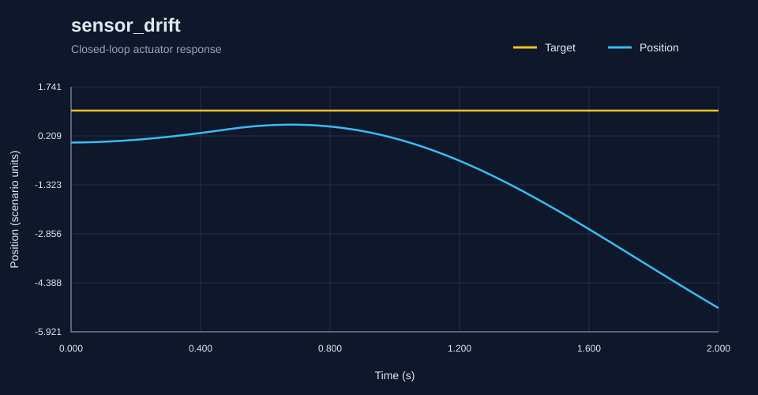
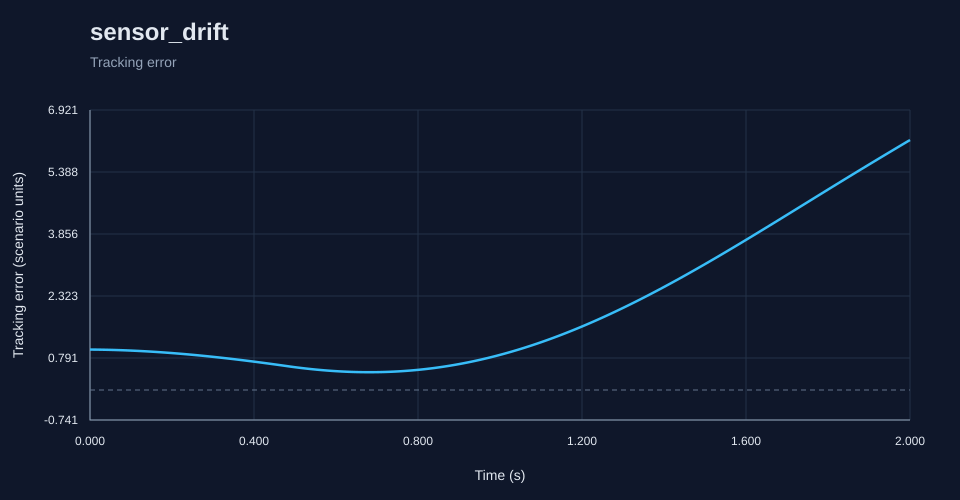

# RoboSim report: sensor_drift

Generated by the C++ simulation engine.

Status: **PASS**

## Metrics

- **acceleration_limit_violations**: 0
- **actuator_acceleration_violations**: 0
- **actuator_velocity_violations**: 0
- **command_limit_violations**: 0
- **control_effort**: 10.08652896989808
- **diagnostic_count**: 2
- **duration**: 2.0
- **emergency_stop**: false
- **fault_count**: 151
- **fault_detection_latency**: 1.32
- **feedback_delay_diagnostics**: 0
- **final_error**: 6.1791448286573125
- **integral_absolute_error**: 3.978602734780699
- **integral_squared_error**: 13.826968369118383
- **invalid_readings**: 0
- **max_command**: 10.0
- **max_error**: 6.1791448286573125
- **max_velocity**: 6.259977476265421
- **mean_absolute_error**: 1.9794043456620392
- **mean_measurement_age**: 0.0
- **overshoot**: 0.0
- **passed**: true
- **peak_error**: 6.1791448286573125
- **position_limit_violations**: 0
- **reason**: pass
- **rise_time**: 1.28
- **rmse**: 2.622801696822487
- **safe_state**: true
- **safe_state_time**: 1.82
- **samples**: 201
- **saturation_fraction**: 0.8855721393034826
- **scenario**: sensor_drift
- **sensor_unchanged_diagnostics**: 0
- **settling_time**: null
- **steady_state_error**: 5.601452599894449
- **velocity_limit_violations**: 0

## Diagnostics

- `0.5s` WARNING SENSOR_DRIFT: fault active: sensor_drift
- `1.82s` ERROR SAFE_STATE: position error limit exceeded
