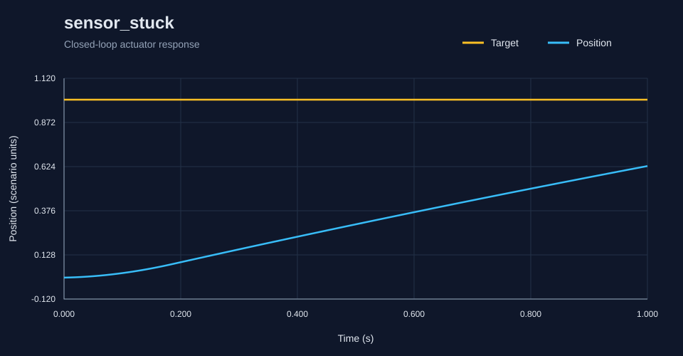
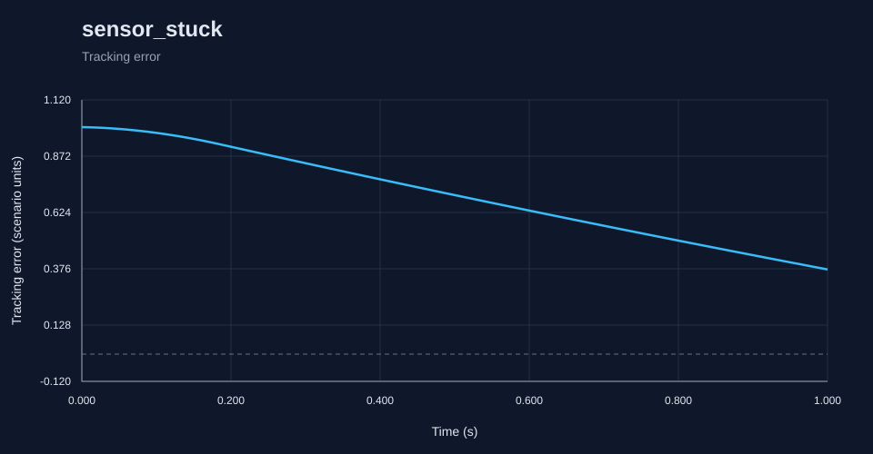

# RoboSim report: sensor_stuck

Generated by the C++ simulation engine.

Status: **PASS**

## Metrics

- **acceleration_limit_violations**: 0
- **actuator_acceleration_violations**: 0
- **actuator_velocity_violations**: 0
- **command_limit_violations**: 0
- **control_effort**: 0.7474997603473083
- **diagnostic_count**: 2
- **duration**: 1.0
- **emergency_stop**: false
- **fault_count**: 81
- **fault_detection_latency**: 0.0
- **feedback_delay_diagnostics**: 0
- **final_error**: 0.3728445142360802
- **integral_absolute_error**: 0.7091195837730545
- **integral_squared_error**: 0.5361293259175742
- **invalid_readings**: 0
- **max_command**: 4.002
- **max_error**: 0.9995998
- **max_velocity**: 0.7330505748913473
- **mean_absolute_error**: 0.7020985977951035
- **mean_measurement_age**: 0.0
- **overshoot**: 0.0
- **passed**: true
- **peak_error**: 0.9995998
- **position_limit_violations**: 0
- **reason**: pass
- **rise_time**: null
- **rmse**: 0.7285747146105713
- **safe_state**: true
- **safe_state_time**: 0.2
- **samples**: 101
- **saturation_fraction**: 0.19801980198019803
- **scenario**: sensor_stuck
- **sensor_unchanged_diagnostics**: 0
- **settling_time**: null
- **steady_state_error**: 0.4010441248694779
- **velocity_limit_violations**: 0

## Diagnostics

- `0.2s` WARNING SENSOR_STUCK: fault active: sensor_stuck
- `0.2s` ERROR SAFE_STATE: sensor stuck fault detected
